# xTime

Таблица команды из сообщений в Telegram. Сотрудники присылают в темы группы-форума расписание на неделю и дейлик в конце дня. Бот разбирает их детерминированным парсером, а сайт показывает таблицу, отчёты за месяц и графики вместо Google-таблицы, которую раньше заполняли руками.

[](.github/workflows/ci.yml)


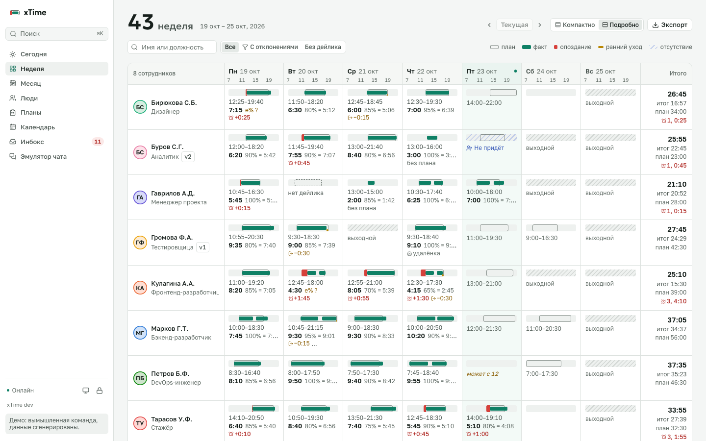

<details>
<summary>Тёмная тема и телефон</summary>

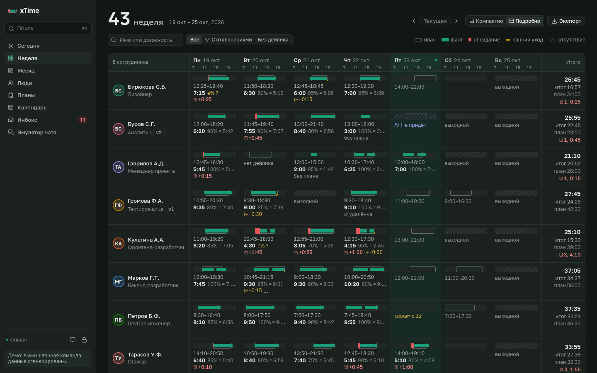

<p>
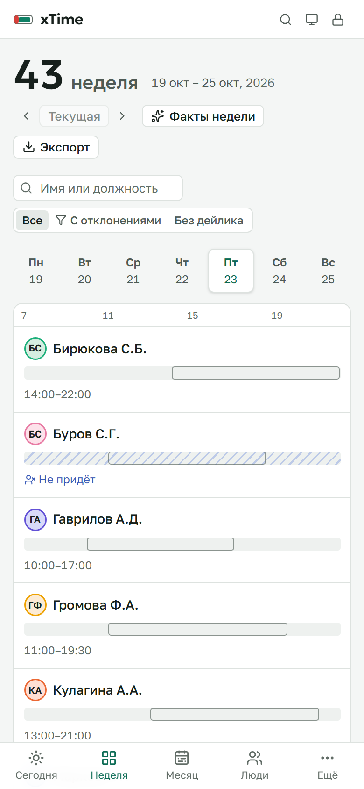
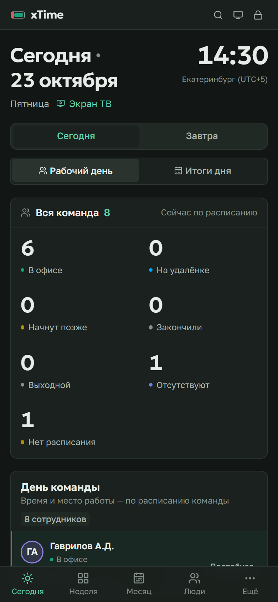
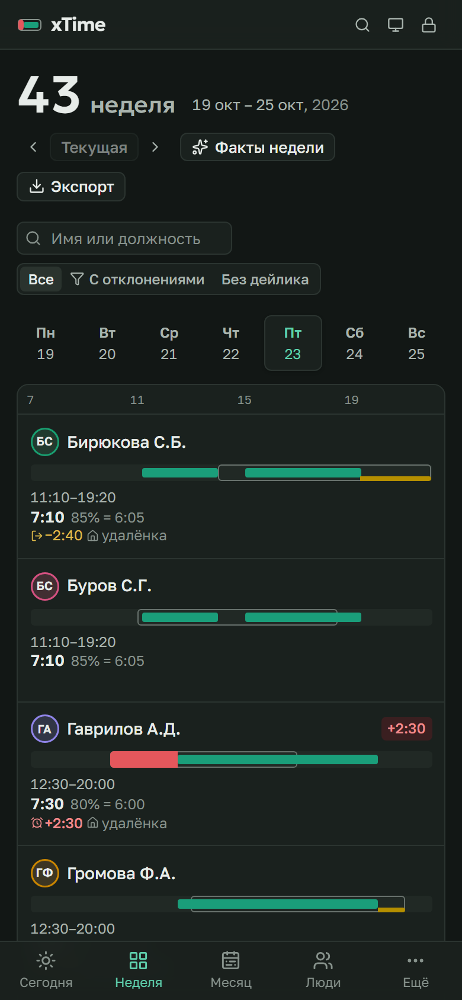
</p>
</details>

Все люди, сообщения, ставки и суммы на скриншотах вымышленные: их создаёт seed-генератор.

## Зачем

Раньше админ переносил данные из чата в общую Google-таблицу: план, приход, уход, часы, эффективность, итоги месяца, опоздания, премии. Это занимало время и давало ошибки. Пустой план, например, превращал всё время прихода в «опоздание», а по готовой цифре нельзя было понять, из какого сообщения она взялась.

xTime делает то же самое автоматически и честнее:

- **Ничего не придумывает.** Нет дейлика — факт пустой, а не нулевой. «Нет дейлика», «выходной», «отпуск» и «0 часов» различаются.
- **Любая цифра прослеживается** до исходного сообщения и всех его правок. Кнопка «показать источник» есть в каждой ячейке.
- **Исходные сообщения неизменяемы.** Правки в чате и правки админа — это новые версии, а все ручные изменения пишутся в журнал.
- **Считает как таблица.** Формулы и округление воспроизведены точно и проверены золотыми тестами (см. «Расчёты»).

xTime не строит рейтингов и не оценивает людей. Эффективность (e%) — это число, которое сотрудник сам пишет в дейлике. Система только переносит его в отчёт. Люди везде упорядочены по фамилии.

**[Финансы](docs/finance.md)** — расчёт за месяц: полный оклад по норме и часовой ставке, оплата переработки и проектные премии администратора. Расшифровка по сотрудникам, история изменений премий и выгрузка в Excel/CSV. Фактические выплаты не отмечаются.

## Возможности

| Экран | Что показывает |
|---|---|
| **Сегодня** | Два режима: «Рабочий день» и «Итоги дня». В рабочем дне — вся команда по расписанию, фильтры по присутствию, задачи выбранного сотрудника и ближайшие изменения. В итогах — дейлики, часы, выполненные задачи и опоздания за выбранную дату (по умолчанию — вчера). У часов указан город и UTC-смещение из настроек |
| **Экран ТВ** | Отдельный `/tv` на основе «Сегодня»: часы с секундами, список команды с полосами расписания на общей шкале, ближайшие начала и окончания работы, короткий обзор завтра. Автоматическая смена страниц, без навигации и кнопок. [Описание и подключение](docs/tv-screen.md) |
| **Неделя** | Замена Google-таблицы: сотрудники × дни. Полоса дня (план контуром, факт заливкой, опоздание красным, ранний уход янтарным), часы, e%, итог. Компактный и подробный режимы, фильтры, экспорт XLSX/CSV, «пульс недели» и сводка расхождений плана и факта |
| **Месяц** | Три итоговые таблицы исходного листа: «Итог за месяц», «Опоздания», «Премии» с расшифровкой расчёта. График шкалы штрафа с точками сотрудников и калькулятор «сколько штрафа за N часов». Динамика по неделям, сравнение месяцев, распределение опозданий, крупнейшие отклонения, печать |
| **Сотрудник** | Профиль с фото, Telegram, телефоном и описанием, сегодняшнее расписание и задачи недели. Итоги месяца и норма, часы, эффективность, хитмап, пунктуальность, серии, задачи спринта против сделанного, заметки, журнал правок. Фото, телефон и описание заполняет админ |
| **Планы** | Расписания недели, версии плана и различия между ними, задачи спринта |
| **Календарь** | Отпуска и больничные на месяц, «кто на месте одновременно» по 15-минутным слотам |
| **Инбокс** | Что бот не понял: исходный текст с подсветкой строк, сравнение версий расписания и влияния одобрения на опоздания, привязка аккаунта |
| **Админка** | Сотрудники (норма, ставка, должность), аккаунты и темы Telegram, допуски и шкала штрафа, праздники, бот, импорт истории, журнал правок |
| **⌘K** | Поиск по людям, датам («23.10») и задачам |

**Факты недели и месяца** открываются одноимённой кнопкой над таблицей. Это самые ранние начала и поздние окончания работы, самый длинный рабочий день, максимальное опоздание, день с наибольшей суммой часов команды, средняя длительность и число задач в дейликах. Расчёт идёт по всей команде независимо от фильтров таблицы; будущие даты исключены. Равные значения учитываются вместе, каждая запись ведёт к исходному дню. Окончание ночной смены помечается «+1 дн.».

**Правка расписания в инбоксе** показывает дни до и после изменения, добавленные и убранные задачи. Для поздней правки видны действующий план и результат её одобрения, включая опоздание по уже присланному дейлику. «Одобрить новый план» действительно применяет его и пересчитывает таблицу: перенос начала может уменьшить опоздание до нуля. Перед действием открывается подтверждение с расчётом. «Игнорировать» исключает производные данные сообщения; предыдущая версия того же сообщения автоматически не восстанавливается.

**Списки работ** в «Сегодня» и профиле показывают текст из исходных расписаний и дейликов. Длинные списки раскрываются с внутренней прокруткой. Ручного трекера, приоритетов, назначения задач на дни и статусов выполнения нет.

**Сегодня и завтра.** Переключатель дня показывает расписание, отсутствия и задачи на следующий день. «Планы» показывают, кто не прислал расписание, не указал задачи или пропустил рабочие дни. Присутствие остаётся оценкой по расписанию; новые состояния перерывов и ночного присутствия пока отложены.

**История условий.** Нормы, ставки и правила сохраняются с месяцем начала действия; неактивные сотрудники с данными остаются в исторических отчётах. Экспорт недели и месяца позволяет выбрать всю команду или текущий отбор. Подробнее — [рабочие процессы](docs/workflows.md) и [список мест для проверки](docs/review-guide.md).

**Согласование и диагностика.** `/absent` создаёт заявку; до решения администратора статусы не меняются. Заявки находятся во вкладке инбокса рядом с сообщениями; сообщения можно отбирать по дате, листать страницами и сортировать от старых к новым. «Админка → Состояние системы» показывает связь бота с Telegram, доставку реакций и напоминаний, доступность личных сообщений и результат `backup.sh`.

**Настройка фото** в редакторе сотрудника позволяет перемещать снимок мышью, пальцем или стрелками и менять масштаб от 100% до 400%. Круглый предпросмотр показывает будущий аватар. На сервер сохраняется выбранный квадрат 256 × 256; исходное фото остаётся в браузере. Сохранённое фото можно дополнительно настроить, для выбора области за пределами прежнего кадра нужно загрузить исходный снимок заново.

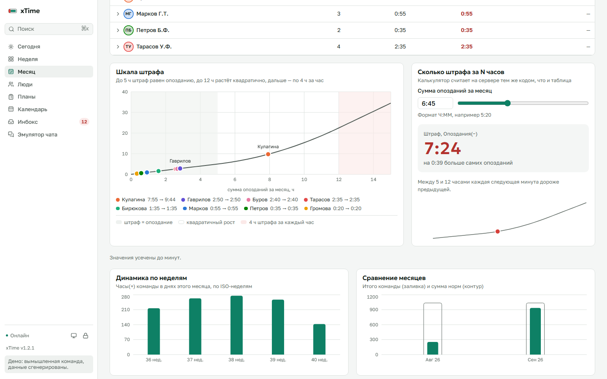

<details>
<summary>Ещё скриншоты</summary>

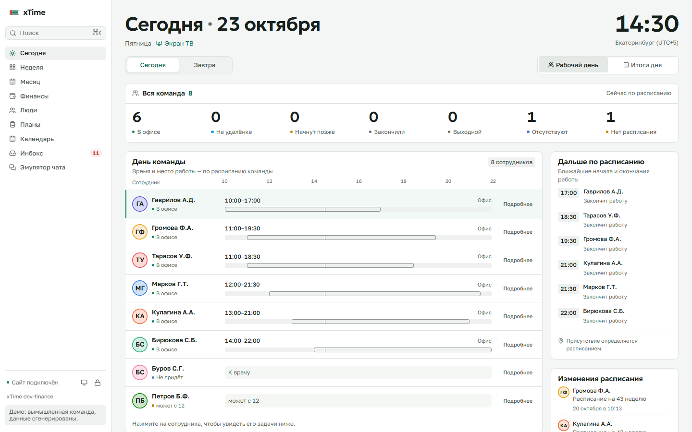
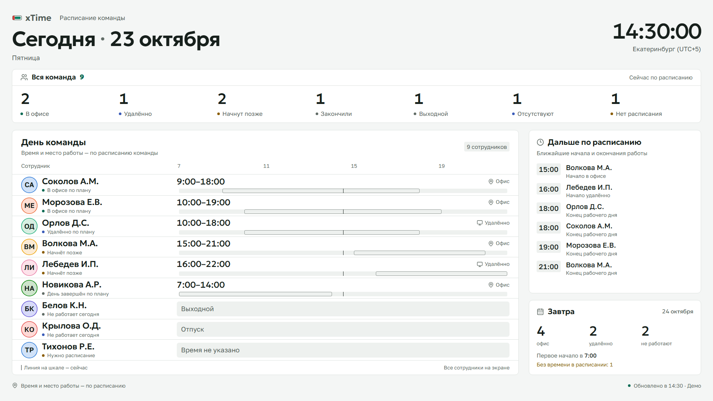
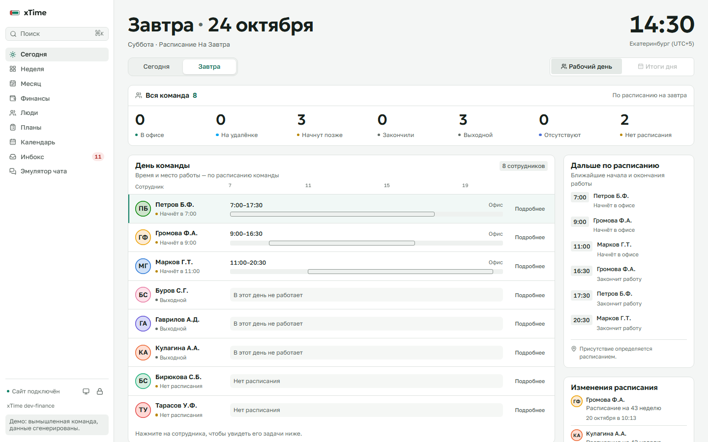
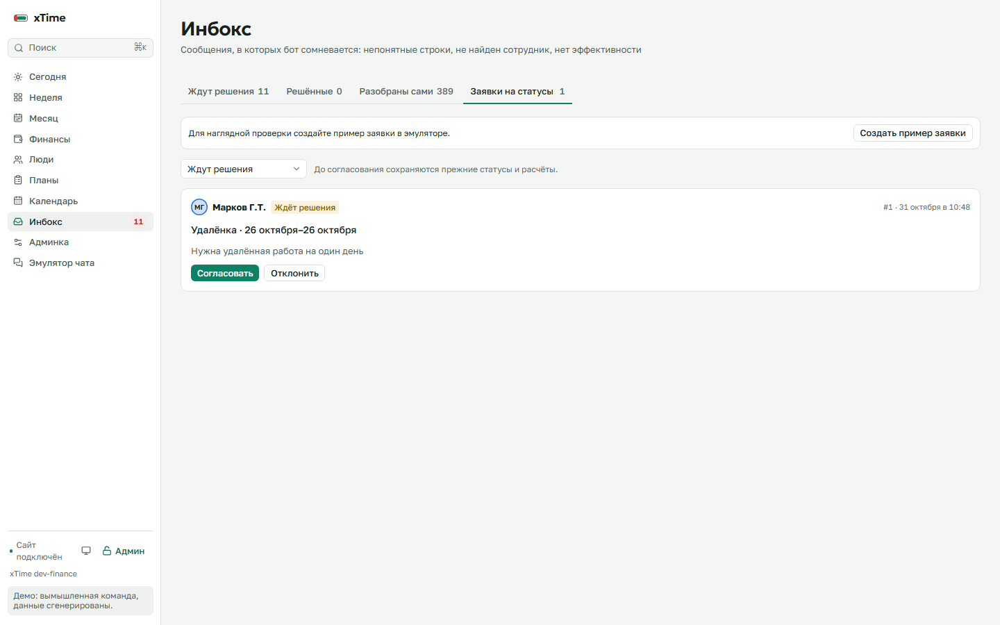
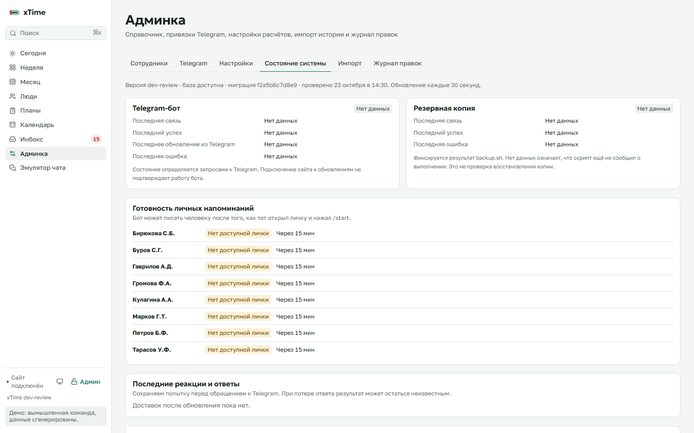
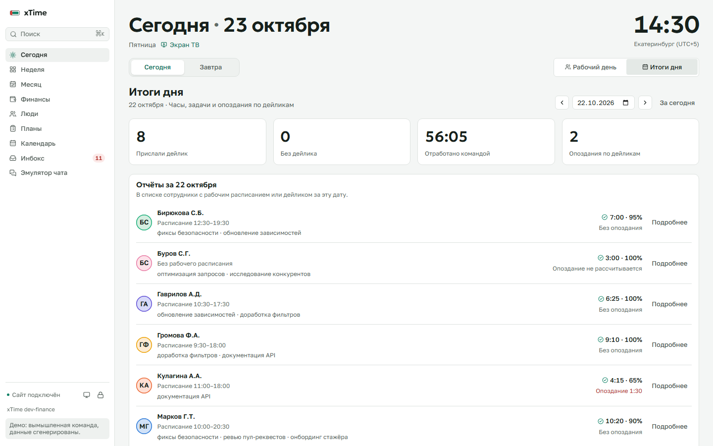
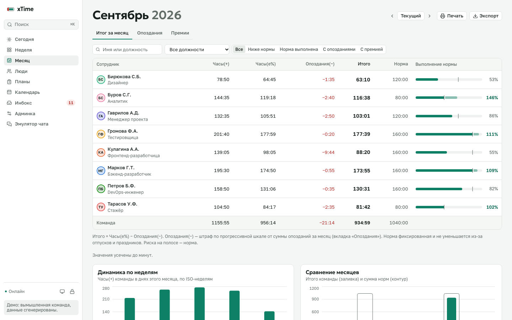
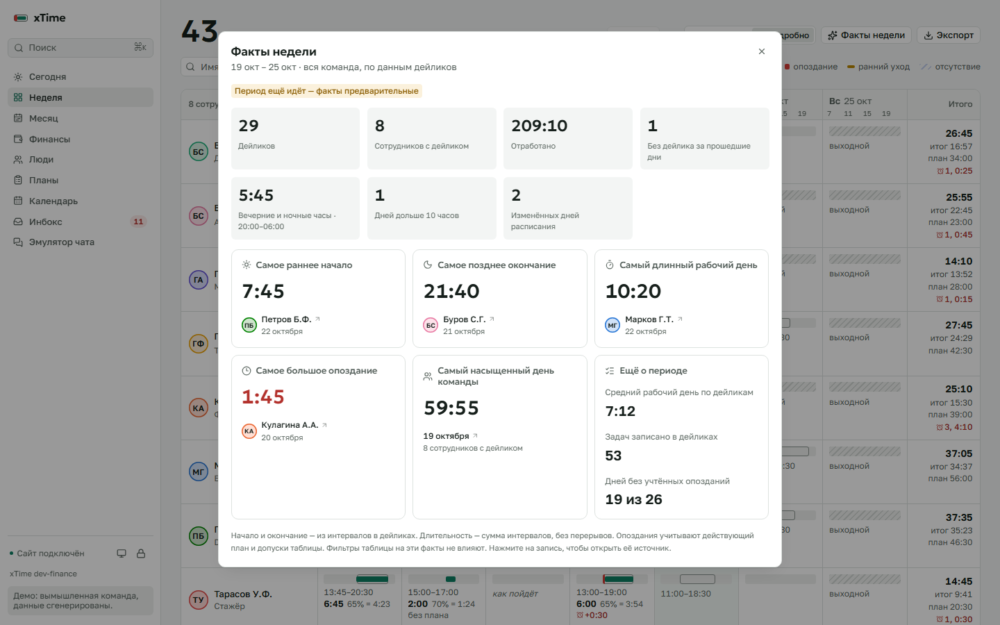
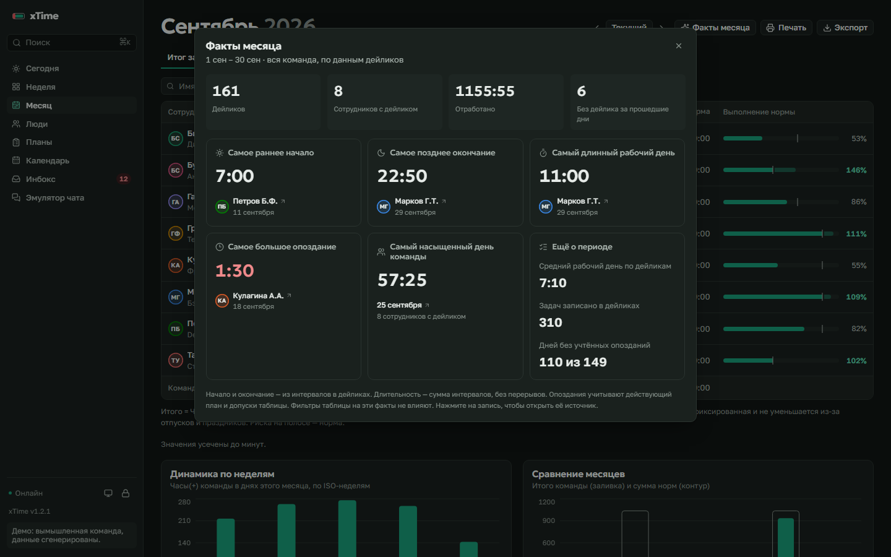
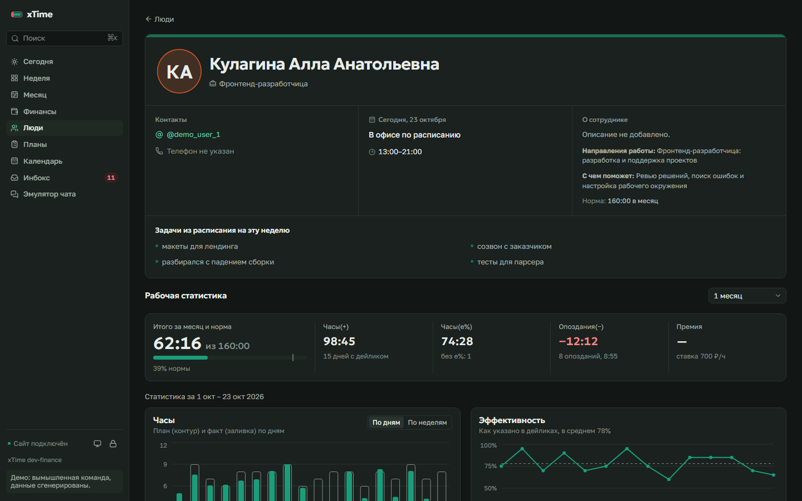
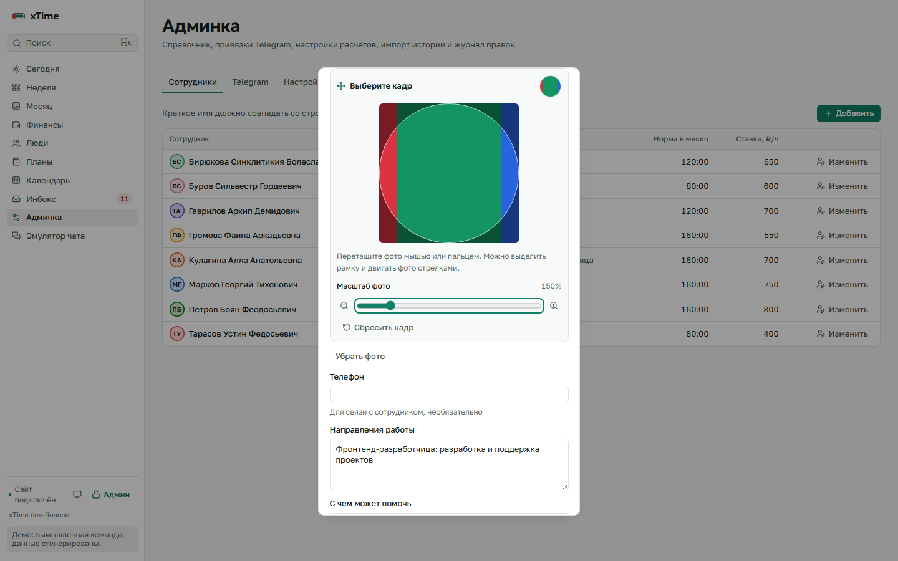
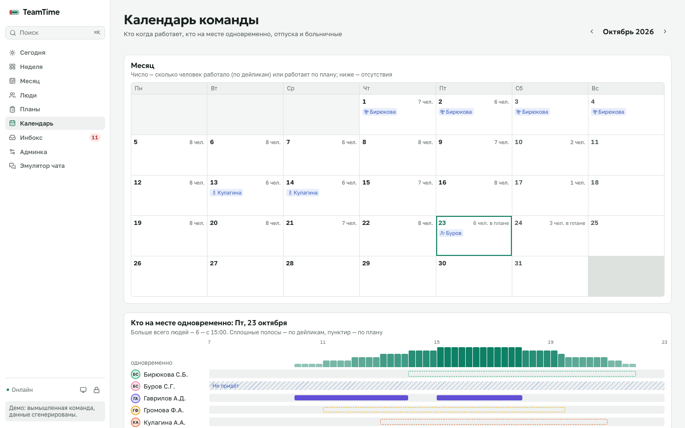
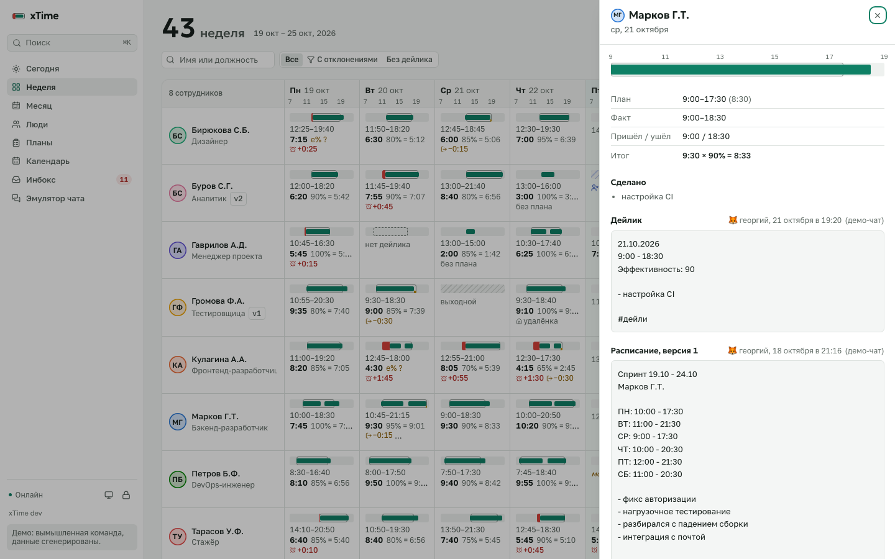
</details>

**Обновления в реальном времени.** Новое сообщение в чате появляется на открытом сайте без перезагрузки: строка подсвечивается, приходит ненавязчивое уведомление.


## Быстрый старт

Нужен Docker с Compose v2.

```bash
git clone https://github.com/OWNER/teamtime.git && cd teamtime
echo "DEMO=1" > .env          # вымышленная команда и эмулятор чата
docker compose up -d --build
open http://localhost:8080
```

`docker compose up` поднимает PostgreSQL, API, бота и сайт. Миграции применяются автоматически, а в демо-режиме пустая база заполняется девятью неделями вымышленных сообщений. Пароль админа в демо — `demo`.

Чтобы демо выглядело одинаково на любую дату (так сделаны скриншоты), «сейчас» можно заморозить: `DEMO_NOW=2026-10-23T14:30:00+05:00`. Перезагрузить демо-данные: `make demo`.

Без Telegram можно попробовать всё через **«Эмулятор чата»**: пишете сообщение от имени вымышленного сотрудника и видите, какую реакцию поставил бы бот и как обновился таблица.

Для отдельного локального демо без бота есть один файл [compose.demo.yml](compose.demo.yml):

```bash
docker compose -p teamtime-workflows-shots -f docker-compose.yml -f compose.demo.yml up -d --build db api web
```

Сайт — <http://localhost:6769>, пароль администратора — `demo`, дата зафиксирована для скриншотов. Этот вариант сохраняет базу уже созданного демо-стенда. Рабочий `.env` остаётся отдельным; временные скрипты и результаты проверок в нём не хранятся.

### Рабочий запуск

```bash
cp .env.example .env
# BOT_TOKEN, BOT_USERNAME, ADMIN_PASSWORD, SESSION_SECRET, PUBLIC_URL
docker compose up -d --build
```

Все переменные описаны в [.env.example](.env.example). Секреты задаются только через `.env`, сам файл в репозиторий не попадает.

### Сервер в локальной сети

`make release` собирает один архив с образами приложения и PostgreSQL, `make deploy HOST=user@сервер` копирует его на сервер и запускает установку. Серверу не нужны Docker Hub, PyPI и npm, а для бота нужен только исходящий доступ к `api.telegram.org` (или прокси в `TELEGRAM_PROXY`). Установка, обновление и бэкапы описаны в [deploy/README.md](deploy/README.md).

## Настройка бота

1. Создайте бота у [@BotFather](https://t.me/BotFather), запишите токен в `BOT_TOKEN`, а имя без `@` — в `BOT_USERNAME`.
2. Выключите Privacy Mode (`/setprivacy` → Disable), иначе бот не увидит сообщения в темах.
3. Добавьте бота в группу-форум администратором с правом ставить реакции.
4. В теме расписаний отправьте `/bind расписание`, в теме дейликов — `/bind дейлики`. Служебные ответы бот удалит сам. Темы можно привязать и на сайте в «Админка → Telegram».
5. Разрешите группу на сайте: «Админка → Telegram → Чаты». Бота может найти и добавить к себе кто угодно, поэтому сообщения он принимает только из разрешённых групп. Привязка темы на сайте разрешает группу сразу.
6. Заведите сотрудников в админке. Поле «Как в расписании» должно совпадать со строкой из сообщений, например `Иванов И.И.`.
7. Привяжите аккаунты Telegram к сотрудникам. Дейлик определяется по отправителю, потому что ФИО в нём нет. Бот сам предложит кандидата, когда человек пришлёт расписание со своим ФИО. После привязки бот переразберёт сообщения этого аккаунта.

**В теме** бот ставит реакцию 👌 (разобрано), ✍ (правка учтена) или 🤔 (есть вопросы). При проблемах отвечает коротким списком: что уточнить, как исправить и ссылка «Исправить в боте». После исправления предупреждение удаляется. В режиме текстовых ответов подтверждает тип сообщения и даты. ✅ и ⚠️ Bot API для реакций ботов не разрешает, эмодзи меняются в настройках.

**В личке** бота:

| Команда | Что делает |
|---|---|
| `/today` | Кто, где и во сколько работает сегодня; кнопка с итогами дня |
| `/day` | Любой день: стрелки, календарь, расписание и итоги; можно `/day 29.10.2026` |
| `/people` | Выбор сотрудника: часы, эффективность, опоздания и задачи за день, неделю или месяц |
| `/week` | Моя неделя: план, факт, итог, задачи спринта |
| `/who` | Команда за неделю |
| `/me` | Моя статистика за месяц: часы, опоздания, штраф, Итого, премия |
| `/absent` | Заявка на отсутствие, удалёнку, больничный, отгул или отпуск; применение после согласования |
| `/daily` | Учёт часов по шагам: дата, интервалы, эффективность, проверка и сохранение |
| `/check` | Что сохранено за мой день и есть ли вопросы к сообщениям |
| `/notifications` | Личные напоминания, задержка и тихое время |
| `/cancel` | Отменить текущий ввод |
| `/fix` | Что бот не понял в моих сообщениях: исправить время или e% кнопками, прислать дейлик заново, уточнить день плана |

Команды работают и в группе: так данные видны вне локальной сети.

**Ответы бота** разделены на блоки с заголовками, выделенными часами и показателями. В месяце есть прогресс нормы и расшифровка итоговой суммы часов. Отчёты и полный список задач доступны прямо в Telegram. Стрелки листают дни, недели или месяцы, кнопка с датой открывает календарь. При смене периода сохраняется выбранный сотрудник; итоги дня относятся к выбранной дате. Большие отчёты и списки сотрудников разбиты на страницы, навигация обновляет одно сообщение. В личке данные доступны привязанным активным сотрудникам, в группе — только если чат разрешён админом. Ссылок на локальный дэшборд в боте нет.

**Напоминания о дейлике** настраиваются в блоке «Бот» в админке. По умолчанию бот напоминает через 15 минут после окончания последнего рабочего интервала, если в таблице ещё нет дейлика. Проверка выполняется раз в минуту. Ночные смены учитываются по исходной рабочей дате. Выходные, праздники, отменённые смены и неактивные сотрудники исключаются. В напоминании есть кнопки темы «Дейлики», проверки сообщений и итогов дня.

**Защита от повторов.** Попытка отправки записывается в БД до запроса в Telegram. Перезапуск, параллельный экземпляр и сбой сохранения после отправки не создают дублей. При таймауте или неопределённом результате автоматического повтора нет: в таком аварийном случае уведомление может быть пропущено. Повторяется только явный ответ Telegram «слишком много запросов» (429), с требуемой паузой и максимум тремя попытками. После простоя догоняются только напоминания за последний час; старая история не рассылается.

Для личных уведомлений сотрудник должен один раз написать боту, например `/start`, а его аккаунт должен быть привязан к сотруднику. Любое обращение в личке запоминает чат для доставки. Если напоминания были выключены в сохранённых настройках, включите их вручную: этот выбор сохраняется при обновлении.

### Импорт истории

Экспортируйте чат из Telegram Desktop в машиночитаемый JSON и загрузите `result.json` в «Админка → Импорт» или выполните:

```bash
docker compose exec api teamtime import telegram /path/result.json
```

Импорт идёт через тот же парсер и идемпотентен: повторная загрузка ничего не дублирует, а сообщения, уже полученные ботом, не задваиваются.

## Формат сообщений

### Расписание (тема «расписание»)

```text
Спринт 26.10 - 31.10
Иванов И.И.

Пн: 12:00 - 18:00
Вт: 10:00 - 18:00
Чт: по вайбу с 16:30 до вечера
Сб: ——————

- задача один
- задача два

#расписание
```

- Год берётся из даты сообщения (с учётом перехода через Новый год), неделя — ISO-неделя начала спринта.
- Строка `Иванов И.И.` — ключ сопоставления с сотрудником. Подпись отправителя в Telegram не важна.
- Дни: `Пн`…`Вс` в любом регистре и полностью. Тире любые (`-`, `–`, `—`), время `6:00` и `06:00` равнозначны, можно несколько интервалов через `;`.
- Прочерк — выходной. Свободный текст («по вайбу») сохраняется заметкой без плана по времени. Если в заметке есть время, парсер его не угадывает, а подсвечивает и даёт уточнить.
- Новое сообщение «Спринт» на ту же неделю или правка старого создают новую версию плана. Вся история версий видна в «Планах».

### Дейлик (тема «дейлики»)

```text
22.10.2026
13:30 - 15:30; 17:30 - 18:40
Эффективность: 100%

- фиксы безопасности
- документация

#дейли
```

- Первая строка — дата рабочего дня, а не отправки: дейлик за 22.10 можно прислать 24.10.
- Интервалы через `;` или `,`. Пришёл — начало первого, ушёл — конец последнего, часы — сумма интервалов.
- «Эффективность» распознаётся без учёта регистра, двоеточия и знака `%`, допускаются сокращения вроде «Эфф».
- Ночной интервал (`22:00 - 02:00`) считается переходом через полночь и даёт предупреждение.
- Второй дейлик за ту же дату заменяет первый, история сохраняется.

У каждого сообщения есть статус `ok`, `partial` или `failed` и список проблем с номером строки. Парсер — чистая функция без сети и базы (`backend/src/teamtime/parsing`), её покрывают около двухсот табличных тестов.

## Расчёты

Правила исходной Google-таблицы воспроизведены в отдельном модуле `backend/src/teamtime/calc` и покрыты золотыми тестами.

**День**

| Величина | Формула |
|---|---|
| Часы | сумма интервалов |
| Итог | Часы × e% |
| Опоздание | max(0, факт прихода − план прихода), только если есть и план со временем, и факт |
| Ранний уход | план ухода − факт ухода, если больше допуска |
| Недоработка | плановая длительность − часы, если больше допуска |

Если плана со временем нет («по вайбу», выходной, отпуск, праздник), опоздания и недоработки нет, а день помечается «без плана». Допуск опоздания по умолчанию 0 минут, как в таблице. Если опоздание превышает допуск, оно считается целиком.

**Месяц** (день относится к месяцу по своей дате)

| Величина | Формула |
|---|---|
| Часы(+) | сумма часов по дням |
| Часы(e%) | сумма итогов по дням |
| Сумма опозданий x | сумма опозданий по дням, в часах |
| Опоздания(−) | штраф по прогрессивной шкале от x |
| Итого | Часы(e%) − Опоздания(−) |
| Переработка | max(0, Итого − норма) |
| Премия, ₽ | переработка в часах × ставка за час |

Шкала штрафа:

```text
x ≤ 5          штраф = x
5 < x ≤ 12     штраф = 5 + (x − 5) + 3·(x − 5)² / 14
x > 12         штраф = 22,5 + 4·(x − 12)
```

Шкала непрерывна (при x = 12 обе ветки дают 22,5) и гладкая: наклон растёт с 1 до 4. Пороги 5 и 12 и коэффициенты 3/14, 22,5 и 4 меняются в «Админка → Настройки». Там же сразу видно, если новые параметры делают шкалу разрывной.

| Опоздания за месяц | 2:17 | 5:20 | 5:40 | 6:10 | 6:45 | 12:00 | 13:00 |
|---|---|---|---|---|---|---|---|
| Штраф | 2:17 | 5:21 | 5:45 | 6:27 | 7:24 | 22:30 | 26:30 |

Норма фиксированная на сотрудника и не уменьшается из-за отпусков и праздников. Пример премии: Итого 127:35, норма 80:00, ставка 625 ₽ → 47:35 × 625 = 29 739,58 ₽.

**Точность.** Всё считается в точных секундах (`fractions.Fraction`): например, 6:43 × 60% = 4:01:48. При показе значения усекаются вниз до минут, как в исходной таблице, поэтому числа совпадают с ней. Деньги округляются до копеек. Рядом с итогами на сайте есть подпись «значения усечены до минут».

## Архитектура

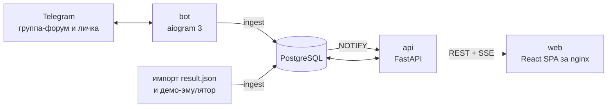

- **Один Python-пакет** `teamtime` для API, бота, импорта и демо. Чистое ядро (`parsing`, `calc`) не зависит от базы и фреймворков, и это проверяет тест.
- **Неизменяемые исходники, версионируемая интерпретация.** У сообщения есть версии текста, у разбора — версия парсера, у планов и дейликов — версии с отзывом. Ручная правка — тоже версия, с записью в журнал.
- **Расчёты не хранятся**, их собирают на лету из актуальных версий. После правок не бывает рассинхронизации.
- **Realtime — SSE поверх `LISTEN/NOTIFY`.** Сайту нужно только получать события, поэтому WebSocket избыточен. SSE — обычный HTTP: он проходит через nginx без особой настройки и сам переподключается. `NOTIFY` транзакционен, так что событие уходит только после коммита. Подробнее — в [ADR 0003](docs/adr/0003-realtime-sse.md).

Документация: [архитектура](docs/architecture.md), [ADR](docs/adr), [решения и компромиссы](docs/decisions.md), [дизайн-система](docs/design.md), [исследование референсов](docs/research.md). OpenAPI с описаниями доступен по адресу `/api/v1/docs`.

**Стек.** Python 3.12, FastAPI, SQLAlchemy 2 (async), Alembic, PostgreSQL 16, Pydantic v2, aiogram 3, structlog. React 19, TypeScript, Vite, Tailwind 4, Radix (компоненты в духе shadcn/ui), TanStack Query, React Router, Recharts, cmdk. Шрифты Geologica и Golos Text самохостятся: сайт работает в локальной сети без интернета.

## Доступ и безопасность

- Сайт рассчитан на локальную сеть команды. Читать его можно без входа: все видят всех, как в общей таблице.
- Режим админа включается паролем из `ADMIN_PASSWORD` и даёт подписанную `HttpOnly`-cookie с `SameSite=Strict`. Изменяющие запросы требуют ещё и заголовок `X-Requested-With`. Неверные пароли ограничены пятью попытками в минуту.
- Подпись сессии привязана к паролю: смена `ADMIN_PASSWORD` завершает все сессии. Без `SESSION_SECRET` ключ подписи случайный на каждый запуск, поэтому подделать cookie нельзя (вход сбросится при перезапуске).
- nginx перезаписывает `X-Forwarded-For` адресом клиента, чтобы лимит попыток входа нельзя было обойти подменой заголовка, и отдаёт CSP, `X-Frame-Options: DENY`, `nosniff` и `Referrer-Policy`. Встроенных скриптов на страницах нет.
- Бот принимает сообщения только из групп, разрешённых админом на сайте. Сводки `/today` и `/who` получают только привязанные сотрудники в личке и участники разрешённой группы. Имена и текст из Telegram в ответах бота экранируются.
- Экспорт CSV и XLSX не превращает текст из сообщений в формулы: в CSV такие ячейки начинаются с апострофа, в XLSX хранятся как текст.
- Это защита от случайных правок и от посторонних в Telegram, но не от злоумышленника внутри сети: читать сайт может любой в локальной сети. Наружу сайт не публикуется: удалённо данные доступны через бота.
- gitleaks в CI проверяет каждый пуш на утечки секретов.

## Разработка

```bash
make install        # venv и node_modules
make dev-db         # PostgreSQL на :5433 для разработки и тестов
make dev-api        # API с демо-данными на :8000
make dev-web        # сайт с HMR на :5173
make check          # всё, что делает CI: ruff, mypy, eslint, tsc, pytest, vitest
make e2e            # Playwright-смоуки на поднятом стеке
make screenshots    # скриншоты и GIF для README
```

Тесты: около 320 на бэкенде (парсер, расчёты, сквозной золотой месяц «сообщения → итог», сервисы на PostgreSQL, API, бот на поддельном Telegram, импорт) и юнит-тесты и e2e-смоуки на фронтенде, включая проверку realtime между вкладками. CI в GitHub Actions поднимает тот же `docker compose` для e2e.

> **macOS и iCloud.** Если проект лежит в синхронизируемой папке (`~/Documents`, `~/Desktop`), iCloud может выгружать файлы из `.venv` и `node_modules`, и тогда Python и Node ломаются непредсказуемо. Держите проект вне iCloud. Если это невозможно, используйте папки `.venv.nosync` и `node_modules.nosync` с симлинками: iCloud такие не синхронизирует, а `.gitignore` их уже исключает.

## Дорожная карта

- **LLM-подсказки для `failed`-сообщений.** Отдельный слой поверх детерминированного парсера: модель предлагает исправление, человек подтверждает. Сам парсер остаётся источником истины.
- **Транскрибация совещаний через Whisper** и привязка обсуждённого к задачам спринта.
- **Анализ задач:** насколько «сделанное» из дейликов покрывает задачи спринта, без оценки людей.
- Несколько команд в одной установке, роли «сотрудник/руководитель» для правок через сайт.
- Синхронизация праздников с производственным календарём.

Проект намеренно не делает: рейтинги и автоматическую оценку людей, слежку за компьютером, налоги, кадровый документооборот, интеграцию с Google Sheets, вход через Telegram Login.

## Лицензия

[MIT](LICENSE)
