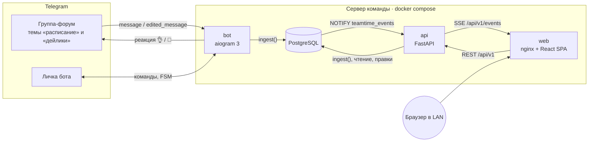
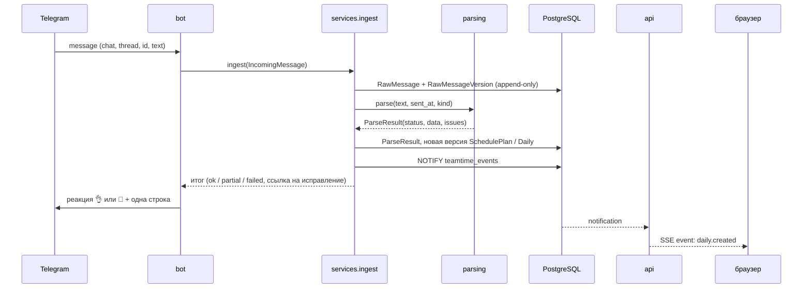
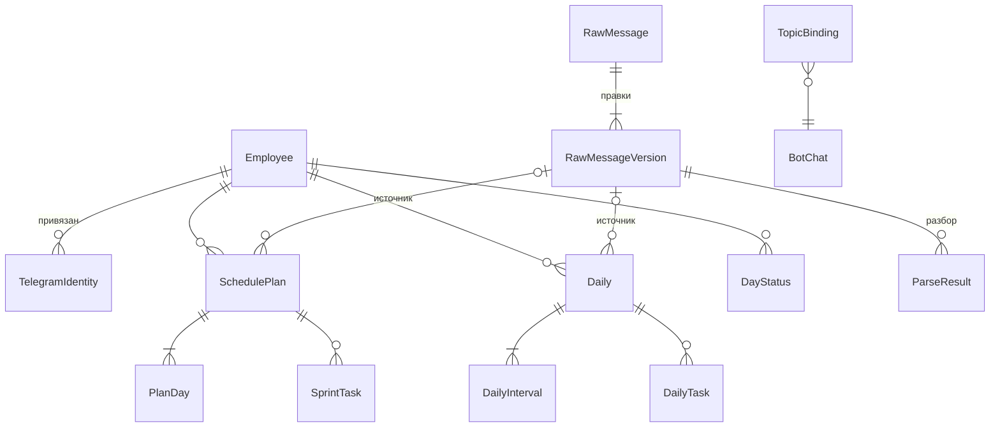

# Архитектура

## Компоненты



Бот и API — два процесса одного Python-пакета `teamtime` с общим доменным ядром. Бот пишет в базу через тот же сервис `ingest`, что и импорт истории и демо-эмулятор. После записи сервис делает `NOTIFY`. API держит одно соединение `LISTEN` и раздаёт события подключённым браузерам по SSE.

## Слои пакета `teamtime`

```
teamtime/
  parsing/     чистые функции: текст → ParseResult (+ предупреждения); без БД и сети
  calc/        чистые расчёты: день, месяц, штрафная шкала, премия; точные секунды
  db/          модели SQLAlchemy 2, сессии
  services/    ingest (сообщение → версии), matching (сотрудник), facts (сборка дней из БД),
               reports (месяц), audit, settings, events (NOTIFY)
  api/         FastAPI-роутеры, схемы Pydantic, SSE, экспорт CSV/XLSX
  bot/         aiogram: группа, личка, команды, FSM исправлений
  importer/    экспорт Telegram Desktop (result.json)
  demo/        seed-генератор и эмулятор сообщений
  cli.py       точка входа `teamtime ...`
```

Зависимости направлены внутрь. `parsing` и `calc` не импортируют ничего из проекта, кроме своих типов. `services` использует их и `db`. Затем `api`, `bot` и `importer` используют `services`.

## Путь сообщения



## Модель данных



Три правила, на которых держится модель:

1. **Исходник неизменяем.** `RawMessage` — это идентичность сообщения `(chat_id, message_id)`. Каждая правка в Telegram добавляет `RawMessageVersion`, старый текст не перезаписывается.
2. **Интерпретация версионируется.** `SchedulePlan` и `Daily` — это версии. Актуальная версия — самая новая неотозванная (`retracted_at IS NULL`) для ключа «сотрудник + неделя» или «сотрудник + дата». Ручная правка админа — тоже новая версия с `source = manual`, плюс запись в `AuditLog`.
3. **Любая цифра прослеживается.** У версии плана или дейлика есть `source_version_id`. По нему сайт показывает исходный текст сообщения и все его правки («показать источник»).

Если правка сообщения переносит дейлик на другую дату, версия по старой дате отзывается. Тогда для старой даты снова становится актуальной предыдущая версия, если она есть.

## Расчёты

Расчёты не хранятся в базе. Их собирают на лету из актуальных версий, статусов дней и настроек (`services.facts` → `calc`). Команда маленькая, месяц — это сотни строк, поэтому денормализация не нужна. Зато не бывает рассинхронизации после правок. Подробно — [ADR 0005](adr/0005-exact-time-arithmetic.md) и раздел «Расчёты» в README.

## Заявки, уведомления и история условий

- `StatusRequest` хранит запрос сотрудника отдельно от `DayStatus`. До одобрения расчёты используют прежние статусы. Решение и применение диапазона выполняются одной транзакцией, повторное решение идемпотентно.
- `EmployeeTerms` и `CalculationVersion` задают условия с месяца начала действия. Отчёты разрешают версии на даты периода; исторический состав включает неактивных сотрудников с данными за период.
- `BotDraft` хранит подтверждение мастера дейлика независимо от памяти FSM. `NotificationPreference` и `DailyReminder` хранят настройки тихого времени, отложенную доставку и единственный запрошенный повтор. Попытка отправки фиксируется до сети.
- `SystemStatus` получает heartbeat из запросов бота к Telegram и результат `backup.sh`; `BotDelivery` хранит исходы реакций и ответов. Диагностика доступна администратору и обновляется независимо от SSE.

Пользовательские сценарии и ограничения миграции описаны в [workflows.md](workflows.md).

## Развёртывание сервисов

| Сервис | Образ | Назначение |
|---|---|---|
| `db` | postgres:16-alpine | данные, `LISTEN/NOTIFY` |
| `api` | `backend/Dockerfile` | при старте `alembic upgrade head`, затем uvicorn |
| `bot` | тот же образ | `teamtime bot run`; не запускается без `BOT_TOKEN` (профиль `bot`) |
| `web` | `frontend/Dockerfile` | статическая сборка, nginx проксирует `/api` (для SSE буферизация выключена) |

## Решения

Ключевые решения оформлены как ADR в [docs/adr](adr/). Мелкие — в [decisions.md](decisions.md).
