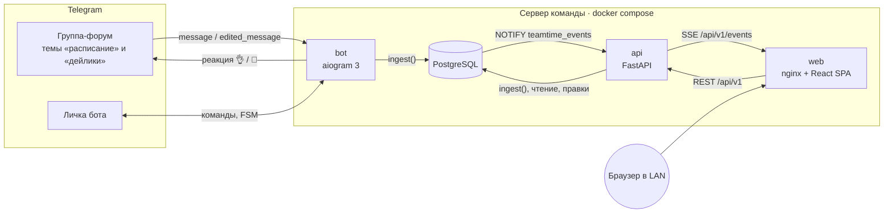
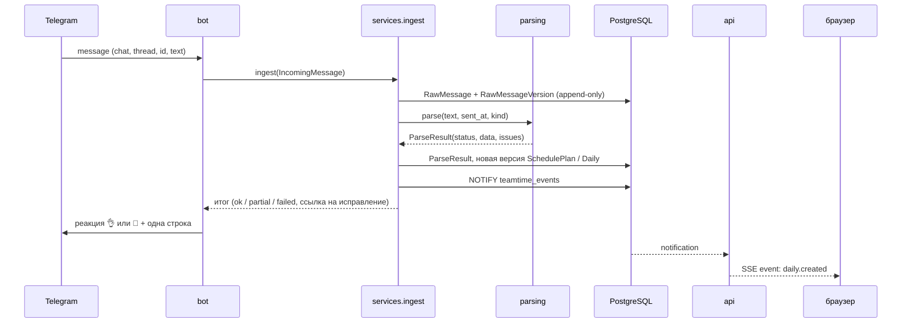
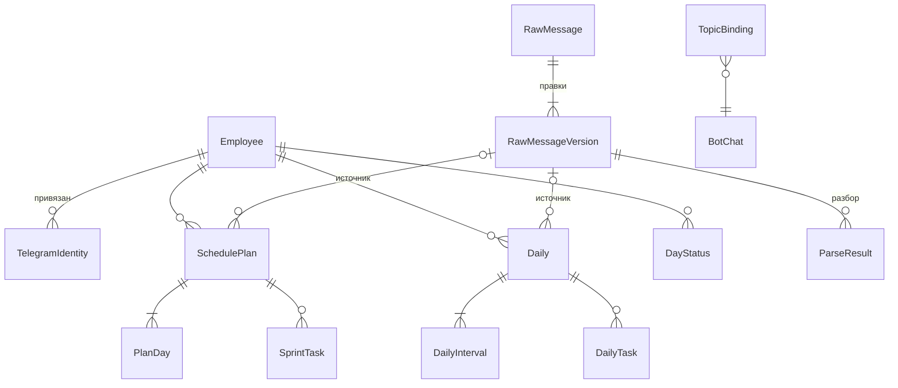

# Архитектура

## Компоненты



Бот и API — два процесса одного Python-пакета `teamtime` с общим доменным ядром. Бот пишет в базу через тот же сервис `ingest`, что и импорт истории и демо-эмулятор. После записи сервис делает `NOTIFY`. API держит одно соединение `LISTEN` и раздаёт события подключённым браузерам по SSE.

Сессия API использует `Depends(get_session, scope="function")`: commit или rollback
завершается до отправки HTTP-ответа. Поэтому подтверждение сохранения означает, что
следующий запрос уже увидит запись; ошибка commit возвращает ошибку клиенту.
Экспорт формирует содержимое до закрытия сессии, SSE использует отдельный broadcaster.

## Слои пакета `teamtime`

```
teamtime/
  parsing/     чистые функции: текст → ParseResult (+ предупреждения); без БД и сети
  calc/        чистые расчёты: день, месяц, штрафная шкала, премия; точные секунды
  db/          модели SQLAlchemy 2, сессии
  services/    ingest (сообщение → версии), matching (сотрудник), facts (сборка дней из БД),
               reports (месяц), audit, settings, events (NOTIFY)
  api/         FastAPI-роутеры, схемы Pydantic, SSE, экспорт CSV/XLSX
  bot/         aiogram: группа, личка, команды, FSM исправлений
  importer/    экспорт Telegram Desktop (result.json)
  demo/        seed-генератор и эмулятор сообщений
  cli.py       точка входа `teamtime ...`
```

Зависимости направлены внутрь. `parsing` и `calc` не импортируют ничего из проекта, кроме своих типов. `services` использует их и `db`. Затем `api`, `bot` и `importer` используют `services`.

## Путь сообщения



## Модель данных



Три правила, на которых держится модель:

1. **Исходник неизменяем.** `RawMessage` — это идентичность сообщения `(chat_id, message_id)`. Каждая правка в Telegram добавляет `RawMessageVersion`, старый текст не перезаписывается.
2. **Интерпретация версионируется.** `SchedulePlan` и `Daily` — это версии. Актуальная версия — самая новая неотозванная (`retracted_at IS NULL`) для ключа «сотрудник + неделя» или «сотрудник + дата». Ручная правка админа — тоже новая версия с `source = manual`, плюс запись в `AuditLog`.
3. **Любая цифра прослеживается.** У версии плана или дейлика есть `source_version_id`. По нему сайт показывает исходный текст сообщения и все его правки («показать источник»).

Если правка сообщения переносит дейлик на другую дату, версия по старой дате отзывается. Тогда для старой даты снова становится актуальной предыдущая версия, если она есть.

Для расписаний правка с ошибкой разбора сохраняет прежний пригодный план. Решение `ignored`
отзывает выбранную интерпретацию расписания и восстанавливает предыдущую пригодную версию
того же сообщения; `accepted` возвращает выбранный план в расчёт. История для применения
сроков уведомления исключает отклонённые версии. Поздняя правка времени требует согласования,
а задачи недели и правки без изменения интервалов обновляются сразу. Ручная правка одного дня
копирует действующие дни недели, чтобы не одобрять спорные изменения других дней.

`DayNoShow` хранит отдельное подтверждение администратора: действовавший план, интервалы,
секунды, причину, автора и время. На сотрудника и день допускается одно активное подтверждение.
Операция сверяет ожидаемые план и секунды, повторный запрос не удваивает часы; отмена сохраняет
строку и аудит. `compute_day` добавляет часы к исходному опозданию только без дейлика, отменяющего
план статуса и календарного праздника. Новый факт приостанавливает подтверждение с флагом
`no_show_conflict`. Месячная прогрессивная шкала применяется к общему опозданию один раз.

## Расчёты

Расчёты не хранятся в базе. Их собирают на лету из актуальных версий, статусов дней и настроек (`services.facts` → `calc`). Команда маленькая, месяц — это сотни строк, поэтому денормализация не нужна. Зато не бывает рассинхронизации после правок. Подробно — [ADR 0005](adr/0005-exact-time-arithmetic.md) и раздел «Расчёты» в README.

## Заявки, уведомления и история условий

- `StatusRequest` хранит запрос сотрудника отдельно от `DayStatus`. До одобрения расчёты используют прежние статусы. Решение и применение диапазона выполняются одной транзакцией, повторное решение идемпотентно.
- `EmployeeTerms` и `CalculationVersion` задают условия с месяца начала действия. Отчёты разрешают версии на даты периода; исторический состав включает неактивных сотрудников с данными за период.
- `BotDraft` хранит подтверждение мастера дейлика независимо от памяти FSM. `NotificationPreference` и `DailyReminder` хранят настройки тихого времени, отложенную доставку и единственный запрошенный повтор. Попытка отправки фиксируется до сети.
- `SystemStatus` получает heartbeat из запросов бота к Telegram и результат `backup.sh`; `BotDelivery` хранит исходы реакций и ответов. Диагностика доступна администратору и обновляется независимо от SSE.

Пользовательские сценарии и ограничения миграции описаны в [workflows.md](workflows.md).

## Учёт фонда

Модуль в разработке и закрыт флагом выпуска `FUND_AVAILABLE=False`. Активность вычисляется
как флаг выпуска и сохранённый `module_enabled`; старое значение в БД не обходит запрет.
`/team/session` сообщает `module_available=false` и `module_enabled=false`. Именной доступ
сохраняет собственный флаг и не снимается автоматически. Следующее описание — для отдельной
сборки разработки с явно разрешённым модулем.

При включённом модуле фонда расчёт с ноября 2026 использует `calc/fund.py` и `calc/fund_time.py`.
Глобальный переключатель `AppSetting[fund].module_enabled` меняет администратор через
`PUT /admin/finance-module`; настройка сохраняется независимо от именного доступа (`enabled`).
Отключение блокирует HTTP-действия и экспорт фонда, личный ввод и напоминания в Telegram,
а месяц и профиль возвращают обычные расчёты. Данные и закрытые снимки не удаляются.
Переключение сериализуется с финансовыми записями, пишет аудит и событие обновления интерфейса.

`services/fund_report.py` собирает подтверждённые факты, один и тот же результат получают
веб, бот `/fund`, экспорт и закрытие. Месячные сводки и профиль подключены через
`fund_time_view.py`. Точное время — Fraction, денежные итоги — Decimal.

- `fund.py`, `fund_setup.py`: участники, календарь, версии условий, поступления и полнота.
- `fund_ledger.py`: журнал и регистры корзин, обязательств, переплат и займов.
- `fund_requests.py`, `fund_corrections.py`: согласования и отдельные разницы закрытых периодов.
- `team_auth.py`: подтверждение входа через Telegram, именные роли, ограниченный доступ ТВ.
- `fund_bot.py`, `bot/handlers/fund.py`: подтверждаемые черновики и финансовые действия в личке.
- `fund_notifications.py`: попытка отправки сохраняется до сети; перезапуск не повторяет её.
- `importer/fund.py`: проверяемый пакет архива, происхождение строк, контрольные суммы и хеш.
- `fund_backup.py`: полная зашифрованная копия, проверка целостности и доставка вне сервера.

Финансовые изменения сериализуются транзакционным замком PostgreSQL. При закрытии
дополнительно блокируются изменения рабочих исходников; повторный запрос защищён UUID
или версией снимка. Закрытый расчёт неизменяем; актуальные выплаты показываются поверх него.
Принятие начисления не создаёт денежный перевод. Сверка не меняет остаток корзины.

Новый расчёт доступен после назначения участников. Именной доступ ко всему приложению
включается отдельно после сверки истории; общий пароль не подменяет финансовые полномочия.
Сентябрь–октябрь сохраняются по историческим правилам. Реальный архив и спорные исходные
часы требуют отдельной сверки, автоматического переноса без подтверждения нет.

Распределение месячного штрафа при смене целевой суммы или доли ставки **не согласовано**:
`penalty_allocation_pending` блокирует расчёт. Условия с одинаковыми суммой и долей ставки
не разбивают единый месячный штраф.

Сценарии, формулы и порядок перехода: [fund.md](fund.md).
Восстановление: [fund-backup.md](fund-backup.md).

## Развёртывание сервисов

| Сервис | Образ | Назначение |
|---|---|---|
| `db` | postgres:16-alpine | данные, `LISTEN/NOTIFY` |
| `api` | `backend/Dockerfile` | при старте `alembic upgrade head`, затем uvicorn |
| `bot` | тот же образ | `teamtime bot run`; не запускается без `BOT_TOKEN` (профиль `bot`) |
| `web` | `frontend/Dockerfile` | статическая сборка, nginx проксирует `/api` (для SSE буферизация выключена) |

## Решения

Ключевые решения оформлены как ADR в [docs/adr](adr/). Мелкие — в [decisions.md](decisions.md).
