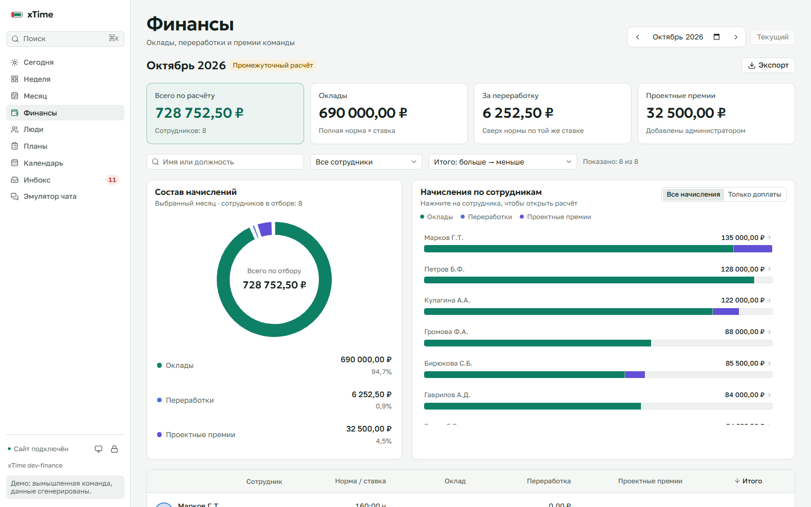
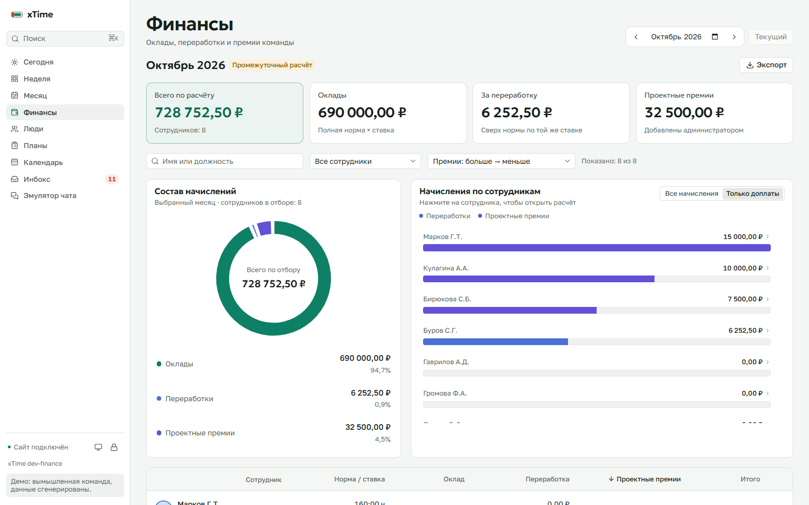
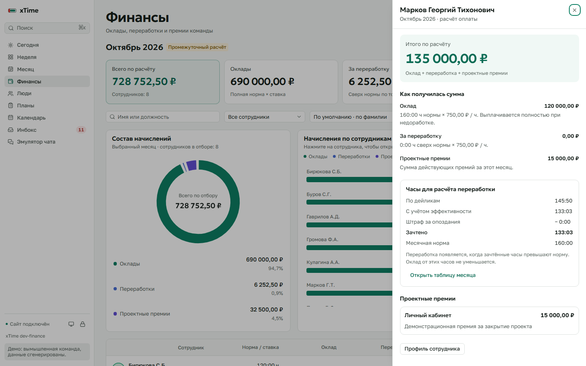

# Финансы

Раздел **Финансы** (`/finances`) показывает расчёт оплаты за выбранный месяц. Доступен всей команде в локальной сети, как остальные отчёты. Добавлять и менять проектные премии может только администратор.

## Формула

- Оклад = полная месячная норма × часовая ставка. Недоработка, отсутствие дейликов и отрицательный итог часов не уменьшают оклад.
- Оплата переработки = `max(0, зачтённые часы − норма) × ставка`. Зачтённые часы — итог таблицы после эффективности и штрафа за опоздания. Берётся тот же точный расчёт, что в месячном отчёте, до усечения отображаемого времени.
- Проектные премии = сумма действующих премий, назначенных администратором этому сотруднику за этот месяц.
- Всего = оклад + оплата переработки + проектные премии.

Например, норма 160 ч, ставка 500 ₽/ч. При 140 зачтённых часах оклад составляет 80 000 ₽. При 170 часах к нему добавляется 5 000 ₽ за переработку. Проектная премия 10 000 ₽ увеличит общий расчёт до 95 000 ₽.

Все денежные расчёты выполняются на сервере с Decimal и округлением до копеек. Норма и ставка берутся из истории условий выбранного месяца. Итог текущего и будущих месяцев обозначен как промежуточный: оклад указан за полный месяц, переработка — только по имеющимся данным. Отметок фактических выплат, авансов, банковских перечислений и налоговых расчётов здесь нет.

## Как пользоваться

1. Выбрать месяц стрелками или полем месяца. Сверху показаны суммы по всей команде.
2. В таблице найти сотрудника по имени или должности. Доступны отборы по переработке, проектным премиям и отсутствующей ставке. Список сортировки меняет порядок по общей сумме, премиям, оплате переработки, окладу, ставке, норме и фамилии — в обе стороны. На компьютере можно также нажимать заголовки столбцов; на телефоне сортировка меняет порядок карточек. Нижняя сумма таблицы относится к текущему отбору.
3. Нажать имя или стрелку сотрудника. Откроется расшифровка оклада, часов и премий. Отсюда можно перейти в таблицу месяца, профиль или настройку нормы и ставки.
4. В режиме администратора нажать **Добавить премию**, выбрать сотрудника, указать проект, сумму и необязательный комментарий. Месяц задан текущим экраном и указан в форме.
5. Для исправления открыть расшифровку сотрудника и нажать **Изменить** у премии. Для отмены требуется причина; запись сохраняется, но больше не входит в сумму. Перенос в другой месяц или другому сотруднику — отмена старой и создание новой записи.

Повтор запроса на создание не добавляет вторую премию. Если два администратора одновременно редактируют одну премию, устаревшая правка будет отклонена. Изменения и отмены записываются в **Админка → Журнал правок**. Перерасчёты и премии обновляются в открытых вкладках через существующее соединение событий.

В блоке **Премии за проекты** есть отдельный поиск по проекту, сотруднику и комментарию. Порядок списка выбирается по сумме, фамилии, названию проекта или времени добавления. Здесь показаны действующие премии за месяц с учётом верхнего отбора сотрудников. Сортировка этого списка независима от таблицы начислений.

Под фильтрами расположены два графика. **Состав начислений** показывает доли окладов, переработок и проектных премий с точными суммами и процентами. **Начисления по сотрудникам** показывает суммы на одной шкале с разбивкой по тем же составляющим. Переключатель **Только доплаты** выделяет переработки и проектные премии. По нажатию на сотрудника открывается его расчёт. Оба графика учитывают текущий отбор; порядок сотрудников совпадает с выбранной сортировкой таблицы. Длинный список прокручивается внутри графика.

Во вкладке **Месяц → Премии** также доступен явный выбор порядка: по сумме премии за переработку, часам переработки, ставке, зачтённым часам, норме или сотруднику.

Сотрудники из архива остаются в месяцах с их расписаниями, дейликами, статусами или премиями. Кадровые даты приёма и увольнения не ведутся; автоматического пропорционального расчёта оклада за неполный месяц нет. Если для конкретного месяца нужна другая норма, её задаёт администратор в условиях сотрудника.

**Экспорт** выгружает всю команду либо текущий отбор в Excel; CSV доступен для всей команды. В Excel отдельные листы содержат расчёт, премии с отменёнными записями и правила. Выгрузка использует те же серверные суммы, что экран.

## Проверка в демо

В новой демо-базе созданы три вымышленные проектные премии. Открыть **Финансы**, затем расшифровку любого сотрудника с премией. В режиме администратора (`demo`) можно добавить тестовую премию, изменить сумму и отменить её: общая сумма и история должны обновляться после каждого действия. Telegram для этого не используется.

