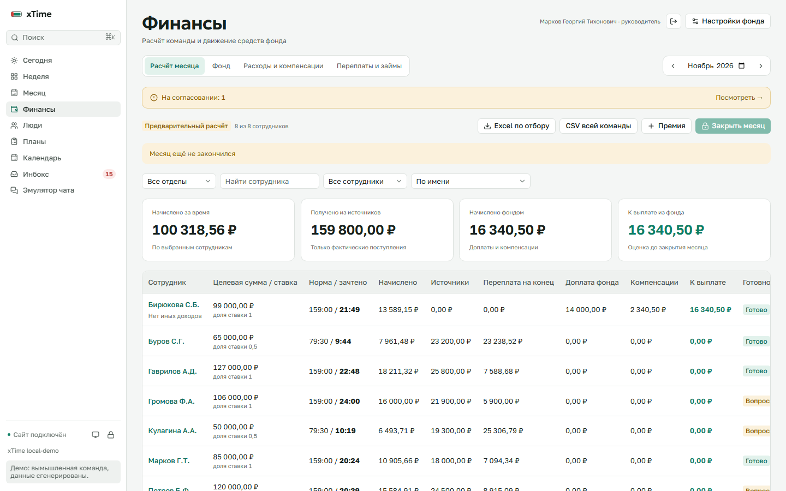

# Учёт фонда с ноября 2026

Фонд — отключаемый модуль существующего раздела **Финансы**: расчёт месяца, фонд,
расходы и компенсации, переплаты и займы. При включённом модуле новая модель применяется
с ноября 2026; ранние месяцы сохраняют обычный расчёт.
Импортированный архив доступен по `/finances/2026/10?fund=1` и переключателю месяца фонда.

## Статус разработки

Модуль фонда пока **недоступен в обычном выпуске**, в том числе в демо. Работают
обычные финансы: оклад, переработки и проектные премии за любой месяц. В админке
осталась только отметка «Модуль фонда — в разработке», включить его кнопкой нельзя.

Флаг выпуска `services/fund_config.py::FUND_AVAILABLE = False` блокирует старое
`module_enabled=true`, API, экспорт, ввод и подтверждения в боте, а также финансовые
напоминания. Команда `/fund` убрана из меню команд, кнопка финансов — из клавиатуры.
Старые сообщения Telegram не удаляются, но их кнопки не могут сохранить операцию.
Обычные напоминания о работе и дейликах продолжают действовать по своим настройкам.

Данные фонда, условия, остатки и закрытые снимки сохранены. Ранее отдельно включённый
именной доступ не снимается автоматически, чтобы обновление не открыло защищённые данные.
Новая установка и демо его не активируют. Резервное копирование остаётся независимым.

Для разработки нужна отдельная сборка с явно изменённым флагом выпуска, затем ручное
включение режима администратором. Серверные тесты включают флаг через `monkeypatch`;
браузерные сценарии фонда пропускаются при `module_available=false`. Флаг отсутствует
в `.env`, поэтому прежняя конфигурация не может включить незавершённую функциональность.

Ниже сохранено описание разработанных экранов и правил для дальнейшей приёмки.

Перед выпуском фонда требуется связать обычные подтверждения невыхода `DayNoShow`
с отдельными решениями фонда о пропусках и исключить двойной учёт. Также нужно проверить
сохранённый `module_enabled`: старое значение не должно включать фонд без нового решения
администратора после снятия флага разработки.

## Проверка в отдельной сборке разработки

После явного включения фонда открыть `/finances/2026/11`, выбрать участника демо-команды. Первый участник — руководитель.
В демо используются вымышленные сведения; Telegram-бот не нужен.

[Проверки реализации и оставшиеся шаги рабочего перехода](fund-verification.md).

- **Расчёт месяца:** отдел, поиск, сортировка, четыре итога по текущему отбору,
  диаграммы, детализация сотрудника, фактические поступления и подтверждение полноты.
  Excel выгружает выбранных сотрудников, CSV — всю команду.
- **Фонд:** остатки корзин, обязательства, свободные деньги, запас в месяцах,
  сверка фактического остатка, журнал черновиков и проведённых операций.
- **Расходы и компенсации:** свои заявки и закрытые вложения, согласование руководителем,
  отсутствия, исключения, корректировки. Запросы также доступны в финансовой вкладке Инбокса.
- **Переплаты и займы:** остатки, история, невыплаченные обязательства, срок займа и просрочка.
- **Настройки фонда:** участие и роли, датированные условия, полный календарь,
  начальные остатки, рабочие годы отпусков, время запросов, получатель копий, ссылка телевизора.
- **История финансовых изменений:** раскрывающийся блок внизу каждой вкладки;
  автор, время, основание, версия условий или календаря, поиск по участнику и действию.

Чужие деньги доступны для просмотра участникам. Для изменения нужны отдельные полномочия.
Выход из именной учётной записи находится в шапке финансов.

## Единый расчёт

`calc/fund.py` и `calc/fund_time.py` — единственное ядро новой модели.
Денежные величины — Decimal до копеек, промежуточное время и коэффициенты — Fraction.
Усечение отображаемых часов не участвует в денежном расчёте.

Целевая сумма уже относится к доле ставки сотрудника: второй раз на долю не умножается.
Норма получается из утверждённого календаря и доли ставки. Отпуск и больничный уменьшают
норму; командировка добавляет восемь эффективных часов без уменьшения нормы.
При полном обнулении положительной нормы согласованным отсутствием сохраняется целевая
сумма соответствующего периода. Отсутствующий календарь не даёт такого результата.

Эффективное время складывается по интервалам. Ночные интервалы делятся по календарным
датам. Отсутствующий дейлик создаёт вопрос; пропуск смены требует отдельного решения.
Уважительное опоздание исключается из исходного времени до применения месячной шкалы.
Шкала применяется один раз за месяц. Распределение штрафа при разных условиях оплаты
внутри месяца **не согласовано**: такой расчёт блокируется с объяснением.

Разница = начисление за время + премии + утверждённые зарплатные корректировки −
фактические выплаты источников. Сначала зачитывается входящая переплата, затем положительная
доплата округляется вверх до тысячи рублей. Округление не становится переплатой.
Компенсации учитываются отдельно и точно до копеек. Отрицательный остаток после фактической
выплаты остаётся видимым. Уменьшение выплаченной компенсации создаёт отдельный отрицательный
остаток компенсации: деньги, зарплата и зарплатная переплата автоматически не меняются.
Фактический добровольный возврат подтверждает ответственный за корзину.

Начисление создаёт обязательство, а не денежное движение. Выплата уменьшает корзину и
распределяется по обязательствам; нераспределённая часть видна отдельно. Внутренний перевод
создаёт две записи одной транзакцией. Исправление денежного факта — связанная обратная операция.
Сверка остатка не является поступлением. Начальный снимок не допускает повторной записи
включённых в него денежных операций задним числом.

Запас фонда = свободные средства / средние расходы и выплаты за последние три закрытых
месяца с учётом возвратов и сторно. Переводы и займы в знаменатель не входят.
При недостатке истории показывается число использованных месяцев.

## Закрытие и исправления

Правка рабочего исходника закрытого месяца попадает в **Инбокс → Фонд** и во вкладку
**Расходы и компенсации**. Руководитель проверяет влияние на сумму, при необходимости
согласует корректировку, затем отмечает исходник проверенным с основанием.
Отметка проверки сама не меняет денег. Новая правка после проверки создаёт новый вопрос.

Руководитель закрывает законченный месяц после подтверждения источников, условий, календаря,
начальных остатков и решения всех вопросов. Данные пересчитываются в транзакции; изменившийся
после просмотра снимок требует повторной проверки. Повторное закрытие того же снимка безопасно.

Закрытый снимок содержит версию правил и исходные данные. Позднее поступление за закрытый
месяц включается один раз в следующий открытый расчёт с указанием исходного месяца.
Часы и условия исправляются заявкой с расчётом разницы; компенсации и ошибочные поступления —
отдельными видами корректировок. Руководитель видит «было / стало», причину и месяц применения.
Исходное начисление и история выплат не создаются заново.

## Telegram и доступ

Веб-вход: команда `/login …` из браузера → подтверждение в личке → именная сессия.
Сотрудник должен иметь подтверждённую привязку Telegram. Общий пароль администратора
не даёт права согласовывать финансы после включения именного доступа.
Первого руководителя назначают под его именной учётной записью с подтверждением технического
администратора; последующие назначения выполняет руководитель фонда.

`/fund` открывает выбор месяца, сотрудников, подробного расчёта, поступлений, расходов,
сверок, операций и запросов. Перед сохранением бот показывает заполненные поля.
Ответственный за корзину отдельно подтверждает денежный факт. Удержание займа требует
согласия заёмщика. Техническая роль сама по себе не даёт права закрытия или согласования.

18 и 19 числа запрашивается текущий месяц, 2 и 3 — предыдущий и незавершённые периоды.
Повторный запрос учитывает полноту ответов. Попытка отправки фиксируется в БД до обращения
к Telegram; после таймаута или перезапуска автоматического повтора нет. Пропущенный запуск
старше часа не догоняет человека пачкой уведомлений. Без начатой лички отправки нет.

Необязательный разбор свободного текста: `FUND_OLLAMA_URL` и `FUND_OLLAMA_MODEL`.
По умолчанию выключен. Модель предлагает поля черновика, не считает деньги, не меняет роли,
не согласовывает операции. Неизвестные суммы и даты запрашиваются у человека. При ошибке
модели остаётся пошаговый ввод. Работоспособность конкретной модели проверяют отдельно
на обезличенных примерах перед включением.

Исходные личные сообщения и чеки не включаются в общий финансовый просмотр или экспорт.
Чеки доступны автору и руководителю. В публичных основаниях следует писать только учётную
причину без диагнозов, реквизитов и иных личных подробностей.

## Перенос истории

`teamtime import fund package.json --actor ID` выполняет только проверку. Пакет содержит
сопоставленные внутренние ID, подтверждённые исторические суммы, происхождение каждой
строки (книга, лист, ячейки, примечание), снимок корзин, переплат, обязательств и отпусков.
Формальная схема: `teamtime.importer.fund.Package.model_json_schema()`.

Проверка возвращает контрольные суммы, список проблем и SHA-256 версии пакета. Запись:
`teamtime import fund package.json --actor ID --expected-digest HASH`.
Изменение пакета после проверки блокирует запись. Повтор идентичного пакета ничего не добавляет.
Начальные корзины другого владельца требуют его отдельной сверки. Обязательства и выплаты
должны совпасть с историческими строками. Уже включённые в снимок операции остаются
происхождением архива и не проводятся второй раз.

Сентябрь и октябрь сохраняются по историческим правилам, ноябрьский черновик не импортируется
как готовое начисление. Отпускная история до подтверждённого остатка не списывается повторно;
недостающие воскресенья и начало рабочего года не достраиваются.

Перенос реальных архивов и контрольная сверка рабочих данных выполняются отдельно после
устранения ранее отмеченных расхождений. Код импортера не является подтверждением этих сумм.

## Ввод в эксплуатацию

1. Проверить календарь, актуальные условия и подтверждённые Telegram-привязки.
2. Назначить руководителя, владельцев корзин и технического получателя резервных копий.
3. Проверить и перенести согласованный исторический пакет, сверить контрольные суммы.
4. Провести параллельный контрольный расчёт, проверить начисления и остатки по сотрудникам.
5. Создать и проверить ограниченную ссылку телевизора.
6. Настроить [полные резервные копии и восстановление](fund-backup.md).
7. Включить именной доступ в настройках фонда. После перехода вести новые сведения в xTime.
