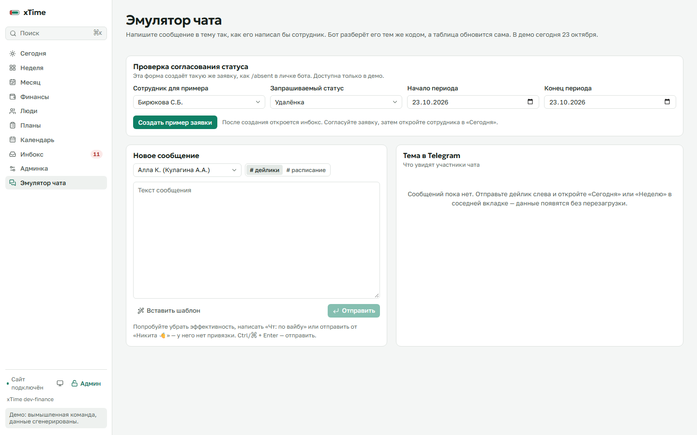

# Где проверить изменения

Это список функций для проверки интерфейса. Все действия для примеров выполняются на отдельном демо-стенде с вымышленными данными. Для админских экранов нужен вход в режим администратора.

| Где | Что проверять |
|---|---|
| Финансы | Выбор месяца, общие суммы и расчёт каждого сотрудника: полный оклад, оплата переработки, проектные премии. Поиск, отборы и Excel/CSV. [Формулы и пример проверки](finance.md). |
| Финансы → фильтры и графики | Сортировка сумм в обе стороны, круговая диаграмма состава начислений и суммы по сотрудникам. Переключение «Все начисления / Только доплаты»; фильтры действуют на оба графика. Ниже — поиск и отдельная сортировка проектных премий. |
| Месяц → Премии | Явный список сортировки по сумме, переработке, ставке, часам, норме и фамилии. Синхронизирован с нажатием заголовков столбцов. |
| Финансы → сотрудник → Проектные премии | Администратор добавляет премию за проект, меняет сумму или отменяет с причиной. Отменённая запись остаётся в истории и не входит в итог. |
| Сегодня → шапка | Крупные часы с часовым поясом. Кнопки «Сегодня / Завтра» сохраняют положение; «Итоги дня» за завтра недоступны. |
| Сегодня → Экран ТВ | Компоновка «Сегодня» без меню и кнопок: сводка всей команды, список с полосами расписания, большие часы с секундами, ближайшие события и завтрашний план. Проверить в 1920×1080 и 1280×720, дождаться смены страниц при большой команде. [Подробности](tv-screen.md). |
| Сегодня → выбранный сотрудник | Прежний текстовый список из расписания, без ручных состояний и приоритетов. |
| Профиль → контакты и фото | Формат телефона, кнопка копирования, просмотр фотографии по нажатию. |
| Профиль → Рабочая статистика | По умолчанию «1 месяц». При выборе другого периода меняются числовая сводка, графики, календарь часов, пунктуальность, серии и списки исходных работ. Высота карточки календаря одинакова для всех периодов; несколько месяцев прокручиваются внутри. |
| Профиль → О сотруднике | Направления работы, с чем сотрудник может помочь, ближайшее согласованное отсутствие. Поля редактируются в «Админка → Сотрудники». |
| Планы → верхние карточки | Кто не прислал расписание, не указал исходный список работ, пропустил рабочие дни или оставил неточные интервалы. |
| Неделя / Месяц → Факты периода | Дополнены часы в календарные выходные, вечерние и ночные часы 20:00–06:00, длинные рабочие дни и серии, изменения расписания. |
| Неделя / Месяц → Экспорт | Выбор всей команды либо текущего отбора сотрудников. Отбор применяется ко всем листам выгрузки. |
| Инбокс → сообщения | Фильтры по дате, порядок от новых или старых, страницы по 25 записей. |
| Инбокс → Заявки на статусы | Согласование, отклонение и комментарий администратора. До решения статус дня не меняется. |
| Админка → Сотрудники | Месяц начала действия нормы и ставки, история условий. |
| Админка → Настройки | Месяц начала действия правил расчёта, просмотр и загрузка сохранённых версий. |
| Админка → Состояние системы | Связь бота с Telegram, результаты реакций и ответов, напоминания, доступность лички, результат резервного копирования. В демо отсутствие данных о боте ожидаемо. |
| Личка бота | `/daily` — часы и эффективность с проверкой перед сохранением; `/check` — сохранённый день; `/notifications` — выключатель, задержка и тихое время. В напоминании доступен один запрошенный повтор через 30 минут. |

## Наглядный пример согласования

1. Войти в режим администратора и открыть «Эмулятор чата».
2. В блоке «Проверка согласования статуса» оставить предложенного сотрудника, «Удалёнка» и сегодняшнюю дату. Нажать «Создать пример заявки».
3. Откроется «Инбокс → Заявки на статусы». Созданная запись выделена рамкой. У неё состояние «Ждёт решения»; текущий статус сотрудника пока прежний.
4. Нажать «Согласовать», при желании написать комментарий, затем «Подтвердить решение».
5. В фильтре «Согласованные» будет видно решение. В «Сегодня» сотрудник перейдёт на удалёнку. Отклонение оставляет прежний статус.

Это тот же сервис заявок, который вызывает `/absent` в настоящем боте. Эмулятор не обращается к Telegram. В боте сотрудник получает номер заявки и кнопки проверки решения и отзыва.

## Удалено после пересмотра

Новый ручной трекер работ, день и приоритет задачи, выполнение, препятствия и переносы; его блоки в неделе, планах, профиле и «Сегодня»; команды и API трекера. Из профиля также убраны прогноз и личная динамика. Новый сбор списка работ в мастере бота убран. Прежние исходные списки сообщений сохранены. Подключения ИИ и автоматического сопоставления задач в этом обновлении нет.
